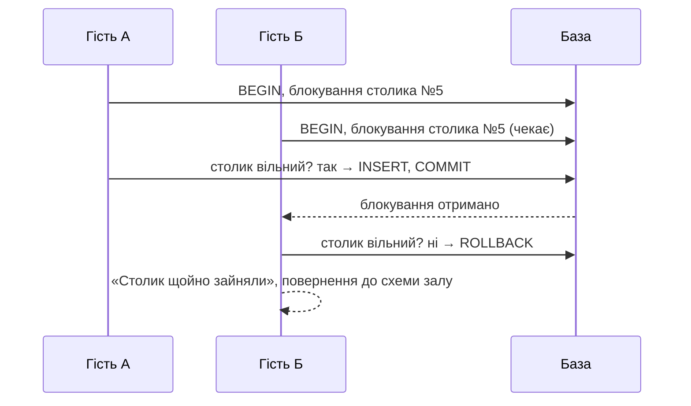

# Захист від подвійного бронювання

## Задача

Столик на конкретний час може дістатися лише одному гостеві. Це має виконуватися завжди: і коли двоє натиснули «Забронювати» в ту саму секунду, і коли менеджер вносить бронювання з дзвінка, поки хтось оформлює той самий столик на сайті.

## Чому це непросто

Наївна реалізація — «перевірити, чи столик вільний, і якщо так — створити бронювання» — складається з двох окремих запитів до бази. Між ними є проміжок, і за одночасних запитів обидва встигають побачити «вільно», а потім обидва створюють запис. У тестах і під час ручної перевірки цього не видно: помилка з'являється лише під навантаженням, тобто в найгірший момент — у п'ятницю ввечері.

Унікальний індекс тут не допоможе: бронювання перетинаються інтервалами (`18:00–20:00` і `19:00–21:00`), а не збігаються за значенням.

## Рішення

Створення бронювання — одна дія [`CreateReservation`](../app/Actions/Reservations/CreateReservation.php), і всередині неї три кроки в одній транзакції:

1. рядок столика блокується (`lockForUpdate`);
2. доступність перевіряється повторно — уже під блокуванням;
3. бронювання створюється.

Блокування ставить одночасні запити на той самий столик у чергу: другий запит чекає на першому кроці, а коли дочекається — перевіряє доступність уже після того, як перше бронювання записано, і отримує виняток [`TableUnavailable`](../app/Exceptions/Booking/TableUnavailable.php). Інтерфейс повертає гостя до вибору столика.

Блокується саме столик, а не таблиця бронювань: запити на різні столики один одному не заважають.

Дія одна на всі входи. Майстер бронювання на сайті й форма в адмінці викликають той самий клас, тож правило не можна обійти, зайшовши «з іншого боку». З цієї ж причини логіки немає ні в контролерах, ні в компонентах Livewire, ні в ресурсах Filament.

Окремо існує утримання столика — [`TableHold`](../app/Services/Booking/TableHold.php): поки гість заповнює майстер, обраний ним столик 10 хвилин виглядає зайнятим для інших. Це ввічливість, а не захист: утримання лежать у кеші, можуть зникнути, і цілісність даних на них не спирається. Робити утримання єдиним механізмом (чернетка бронювання в базі) сенсу немає: з'явилися б «напівбронювання», які треба прибирати, а гарантію все одно давала б транзакція.

## Де в коді

- [`app/Actions/Reservations/CreateReservation.php`](../app/Actions/Reservations/CreateReservation.php) — транзакція з блокуванням;
- [`app/Services/Booking/AvailabilityService.php`](../app/Services/Booking/AvailabilityService.php) — метод `assertBookable()`, повторна перевірка;
- [`app/Services/Booking/TableHold.php`](../app/Services/Booking/TableHold.php) — утримання столика в майстрі;
- [`app/Livewire/BookingWizard.php`](../app/Livewire/BookingWizard.php) — що бачить гість, коли столик зайняли.

## Як перевірено

Тести в [`tests/Feature/Booking/ReservationActionsTest.php`](../tests/Feature/Booking/ReservationActionsTest.php): «із двох запитів на один столик і час створює рівно одне бронювання», «не дає забронювати час упритул до іншого бронювання»; у [`AvailabilityServiceTest.php`](../tests/Feature/Booking/AvailabilityServiceTest.php) — «показує столик, який утримує інший гість, зайнятим».

Чого тести не покривають: справжньої одночасності. Вони йдуть на SQLite в пам'яті одним з'єднанням, тому перевіряють, що другий запит відхиляється, але не те, що блокування рядка справді ставить запити в чергу. Це забезпечує MySQL (InnoDB), і перевірити це можна лише вручну двома з'єднаннями.
