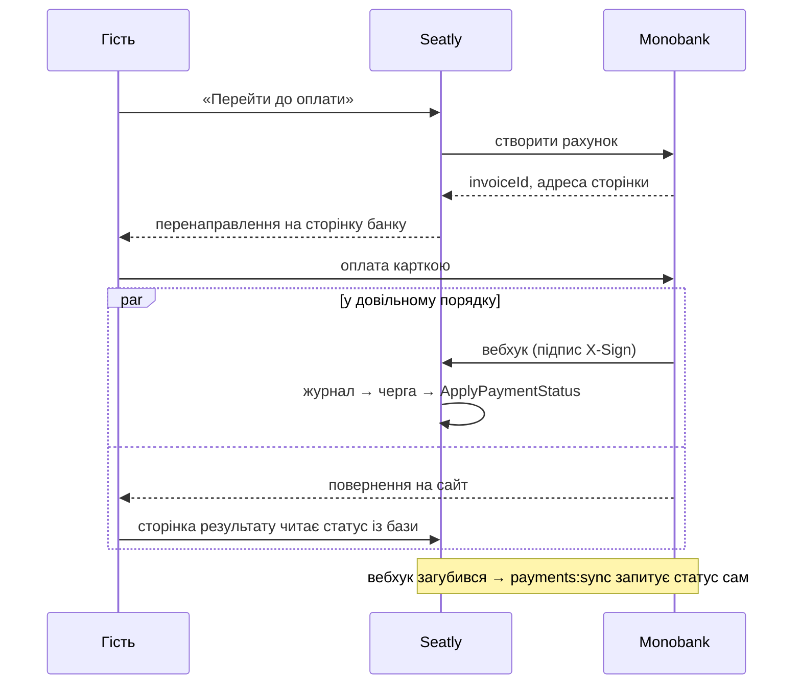

# Вебхуки й узгодженість платежів

## Задача

Після оплати банк повідомляє про неї окремим запитом на сервер — вебхуком. За цим повідомленням платіж стає сплаченим, сума до сплати зменшується, офіціант бачить оплату, а платне бронювання підтверджується.

## Чому це непросто

Вебхук — це запит з інтернету, який стверджує, що гроші надійшли. І поводиться він не так, як хотілося б:

- **Його може надіслати будь-хто.** Адреса вебхука не секретна; без перевірки рахунок «оплачується» одним запитом із термінала.
- **Він приходить кілька разів.** Банк повторює надсилання (Monobank — до трьох спроб на кожну зміну статусу). Якщо на кожен вебхук додавати суму до сплаченого, гість «заплатить» двічі.
- **Він приходить не за порядком.** Повідомлення «обробляється» може наздогнати «успішно» — і тоді сплачений платіж відкотиться назад.
- **Він може не прийти.** Мережа, тунель, перезапуск сервера. А про прострочений рахунок Monobank вебхуком не повідомляє взагалі.
- **Гість повертається на сайт раніше або пізніше за вебхук** — порядок цих двох подій довільний.

## Рішення

**Джерело правди — запис у базі, і змінюють його лише дані провайдера.** Повернення гостя на сторінку результату нічого не означає: сторінка показує статус із бази й чекає.

**Підпис.** [`MonobankWebhookController`](../app/Http/Controllers/Webhooks/MonobankWebhookController.php) перевіряє підпис ECDSA із заголовка `X-Sign` відкритим ключем банку. Ключ кешується; якщо перевірка не пройшла, він запитується повторно (банк міг його замінити), і лише потім запит відхиляється з кодом 403. Кожен вебхук, і чинний, і ні, лишає запис у журналі — без токена картки й інших чутливих полів.

**Швидка відповідь.** Контролер лише перевіряє підпис, пише журнал і ставить обробку в чергу ([`ProcessPaymentWebhook`](../app/Jobs/ProcessPaymentWebhook.php)), одразу відповідаючи 200: банк не чекає на бізнес-логіку й не повторює запит через повільну відповідь.

**Одне місце зміни статусу.** Статус платежу змінює лише дія [`ApplyPaymentStatus`](../app/Actions/Payments/ApplyPaymentStatus.php) — її викликають і вебхук, і запит статусу, і підставний шлюз. Усередині транзакції вона блокує бронювання, замовлення й платіж (завжди в цьому порядку, щоб дві дії не заблокували одна одну) і вирішує, чи є повідомлення новиною:

- статус із меншим «рангом» відкидається: `created` → `processing` → кінцевий (`success`, `failure`, `expired`) → `refunded`, тільки вперед ([`PaymentStatus::rank()`](../app/Enums/PaymentStatus.php));
- той самий статус удруге нічого не змінює;
- повідомлення зі старішим часом зміни, ніж збережений, відкидається; за однакового часу (банк дає його з точністю до секунди) приймається лише рух уперед.

**Ідемпотентність без лічильників.** Сплачена сума замовлення не збільшується на суму платежу, а щоразу перераховується як сума успішних платежів. Повторити перерахунок можна скільки завгодно разів — результат той самий.

**Страховка.** Команда [`payments:sync`](../app/Console/Commands/SyncPendingPayments.php) щохвилини запитує статус платежів, які понад дві хвилини висять неоплаченими, — так система дізнається і про загублений вебхук, і про прострочений рахунок. Сторінка результату теж сама питає банк (не частіше ніж раз на 10 секунд), тому оплата підтверджується навіть у розробці без тунелю.

## Де в коді

- [`app/Http/Controllers/Webhooks/MonobankWebhookController.php`](../app/Http/Controllers/Webhooks/MonobankWebhookController.php) — підпис, журнал, черга;
- [`app/Actions/Payments/ApplyPaymentStatus.php`](../app/Actions/Payments/ApplyPaymentStatus.php) — блокування, правило «чи це новина», наслідки оплати;
- [`app/Actions/Payments/SyncPaymentStatus.php`](../app/Actions/Payments/SyncPaymentStatus.php) — запит статусу в провайдера;
- [`app/Livewire/PaymentResult.php`](../app/Livewire/PaymentResult.php) — сторінка, на яку повертається гість.

## Як перевірено

[`tests/Feature/Payments/PaymentFlowTest.php`](../tests/Feature/Payments/PaymentFlowTest.php): «після успішного вебхука зменшує суму до сплати, а повторний вебхук нічого не змінює», «відкидає вебхуки, що прийшли не за порядком», «за однакового часу зміни приймає лише рух уперед», «тримає один активний платіж». [`MonobankGatewayTest.php`](../tests/Feature/Payments/MonobankGatewayTest.php): «приймає вебхук із чинним підписом», «відхиляє вебхук із неправильним підписом і фіксує його в журналі», «запитує відкритий ключ повторно, якщо Monobank його замінив», «вебхук не потребує сесії й CSRF-токена».

Чого тести не покривають: підпис перевіряється на власній тестовій парі ключів, а не на справжньому ключі банку; два вебхуки, які обробляються справді одночасно, тести не відтворюють — за це відповідає блокування рядків у MySQL.
