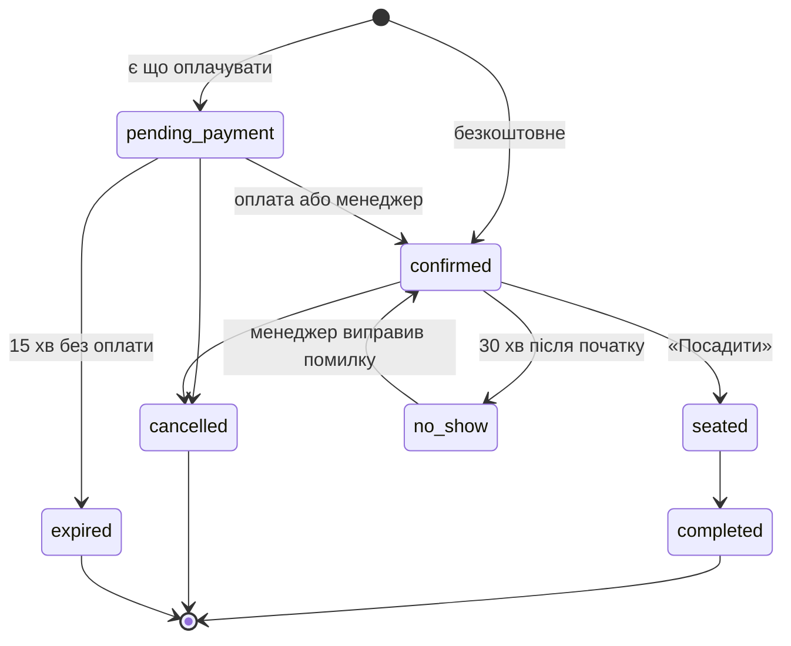

# Статуси бронювання, замовлення й позиції

## Задача

Бронювання, замовлення і кожна страва в замовленні проходять свій життєвий цикл. Від статусу залежить багато: чи зайнятий столик, чи бачить страву кухня, чи можна закрити рахунок, чи повертати гроші.

## Чому це непросто

Статус — це просто рядок у базі, і написати `$reservation->update(['status' => 'seated'])` можна будь-де. Поки переходів два, це працює. Коли їх стає десять, а змінюють статус сайт, адмінка, вебхук і фонові задачі, з'являються стани, яких не мало бути: «посаджене» скасоване бронювання, закрите замовлення з несплаченим залишком, страва, яка після «подано» знову «готується». Кожен такий стан потім ламає звіт або залишає столик зайнятим назавжди.

## Рішення

Три правила, однакові для всіх трьох сутностей.

**1. Дозволені переходи записані в одному місці — у самому переліченні.** Метод `canTransitionTo()` є в [`ReservationStatus`](../app/Enums/ReservationStatus.php), [`OrderStatus`](../app/Enums/OrderStatus.php) і [`OrderItemStatus`](../app/Enums/OrderItemStatus.php). Таблиця переходів читається як документація.

**2. Статус змінюється лише через метод моделі `transitionTo()`.** Він питає перелічення й на заборонений перехід кидає виняток ([`InvalidTransition`](../app/Exceptions/Booking/InvalidTransition.php), [`InvalidOrderTransition`](../app/Exceptions/Orders/InvalidOrderTransition.php)). В адмінці немає форми редагування бронювання чи замовлення з полем «статус»: його змінюють лише кнопки дій.

**3. Перехід виконує дія з `app/Actions`, яка робить і все супутнє.** «Посадити» — це не лише статус: [`SeatReservation`](../app/Actions/Reservations/SeatReservation.php) ще й відкриває замовлення столика або перетворює попереднє замовлення на звичайне. Кнопка в адмінці, сторінка гостя й фонова задача викликають ту саму дію.

Хто що виконує:

| Перехід | Хто |
|---|---|
| `pending_payment → confirmed` | успішна оплата ([`ApplyPaymentStatus`](../app/Actions/Payments/ApplyPaymentStatus.php)) або менеджер дією «Підтвердити без оплати» |
| `pending_payment → expired` | фонова команда `reservations:expire-unpaid` |
| `confirmed → no_show` | фонова команда `reservations:mark-no-show` або менеджер |
| `confirmed → seated`, `seated → completed` | офіціант, менеджер, власник |
| скасування | гість зі сторінки бронювання або менеджер |

Замовлення простіше: `awaiting_payment → open → closed`, з будь-якого незавершеного стану — `cancelled`. Два правила перевіряє не перелічення, а дії: на столику може бути лише одне відкрите замовлення, а закрити його можна тільки з нульовою сумою до сплати.

Позиція рухається лише вперед: `new → cooking → ready → served`. Крок можна пропустити — напій подають одразу, без кухні, — а назад дороги немає. Скасувати можна з будь-якого стану, крім уже скасованого; нову позицію офіціант просто прибирає, розпочату скасовує лише менеджер.

Окремого пакета для скінченних автоматів у проєкті немає: переходів небагато, а `match` у переліченні на десять рядків читається краще за конфігурацію стороннього пакета й перевіряється статичним аналізом.

## Де в коді

- [`app/Enums/ReservationStatus.php`](../app/Enums/ReservationStatus.php), [`OrderStatus.php`](../app/Enums/OrderStatus.php), [`OrderItemStatus.php`](../app/Enums/OrderItemStatus.php) — таблиці переходів;
- [`app/Models/Reservation.php`](../app/Models/Reservation.php), [`Order.php`](../app/Models/Order.php), [`OrderItem.php`](../app/Models/OrderItem.php) — `transitionTo()`;
- [`app/Actions/Reservations`](../app/Actions/Reservations) і [`app/Actions/Orders`](../app/Actions/Orders) — дії, що виконують переходи.

## Як перевірено

[`tests/Feature/Booking/ReservationActionsTest.php`](../tests/Feature/Booking/ReservationActionsTest.php): «проводить бронювання дозволеними переходами», «забороняє недопустимі переходи статусів», повернення «не прийшов» у «підтверджено», лише якщо столик не віддали іншим. [`tests/Feature/Orders/OrderActionsTest.php`](../tests/Feature/Orders/OrderActionsTest.php): «веде позицію лише вперед і дозволяє пропустити крок», «закриває замовлення лише коли до сплати нуль», «не відкриває друге замовлення на тому самому столику», «не змінює закрите замовлення».

Чого тести не покривають: прямого запису в базу в обхід моделі. Правило тримається на домовленості «статус змінює лише `transitionTo()`»; обмежень на рівні бази (тригерів чи `CHECK`) немає.
